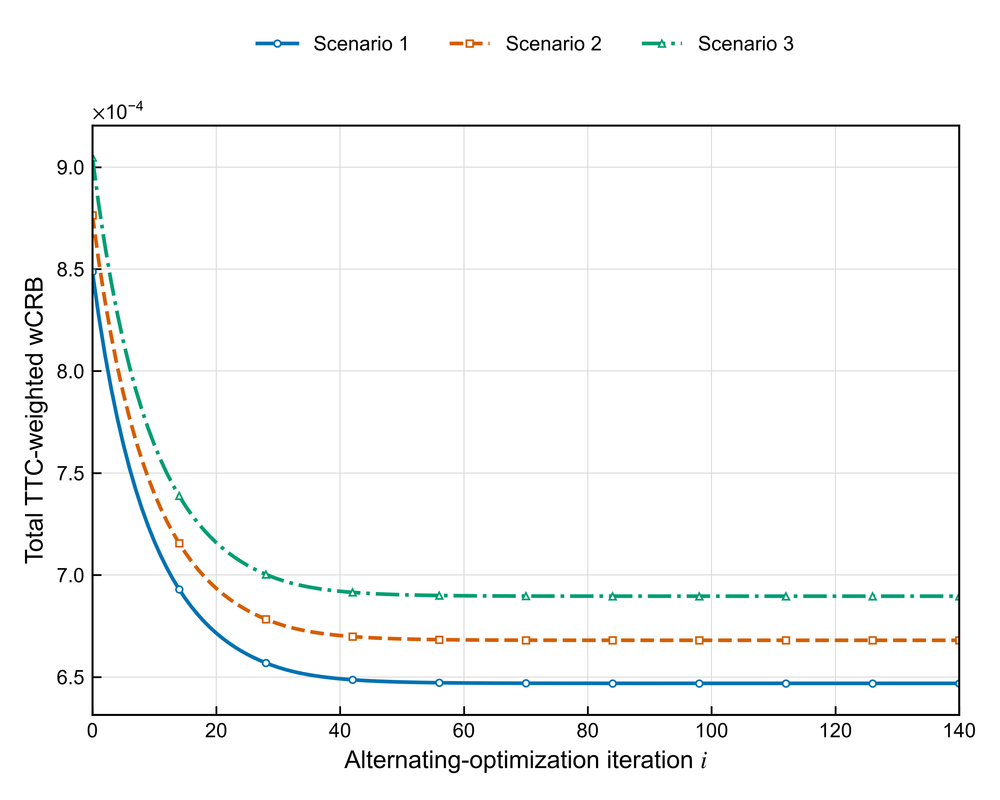
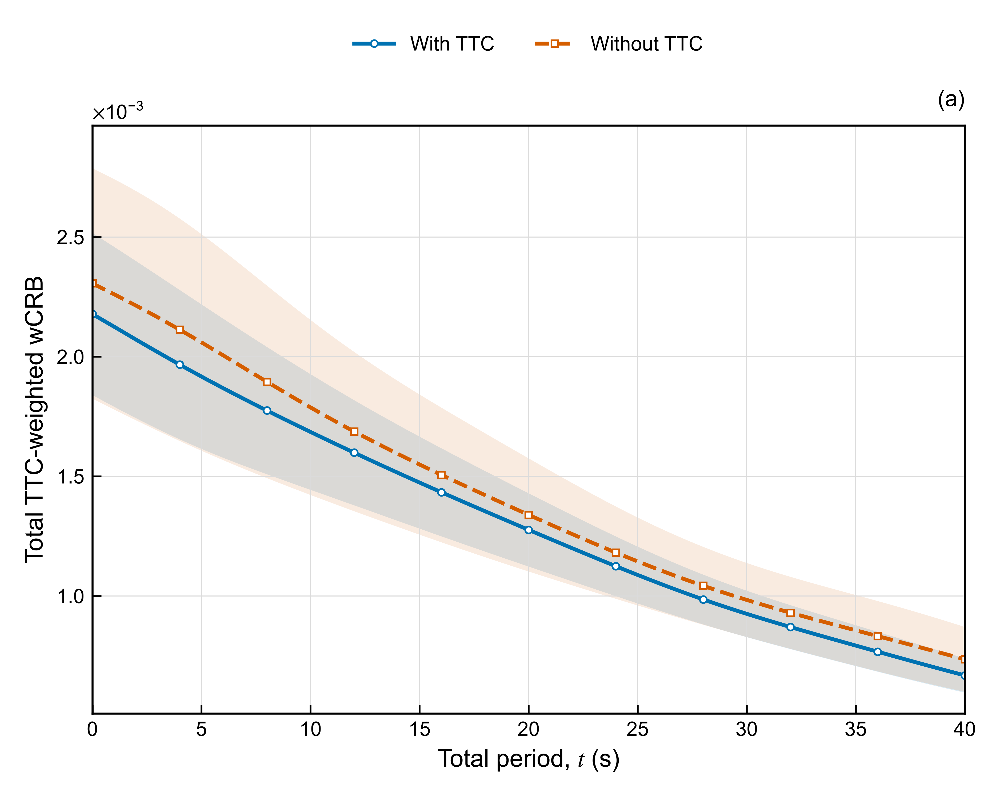
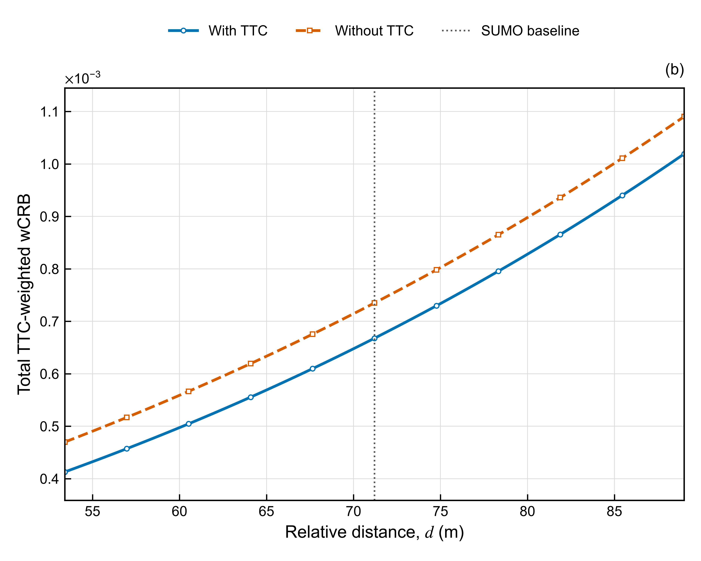
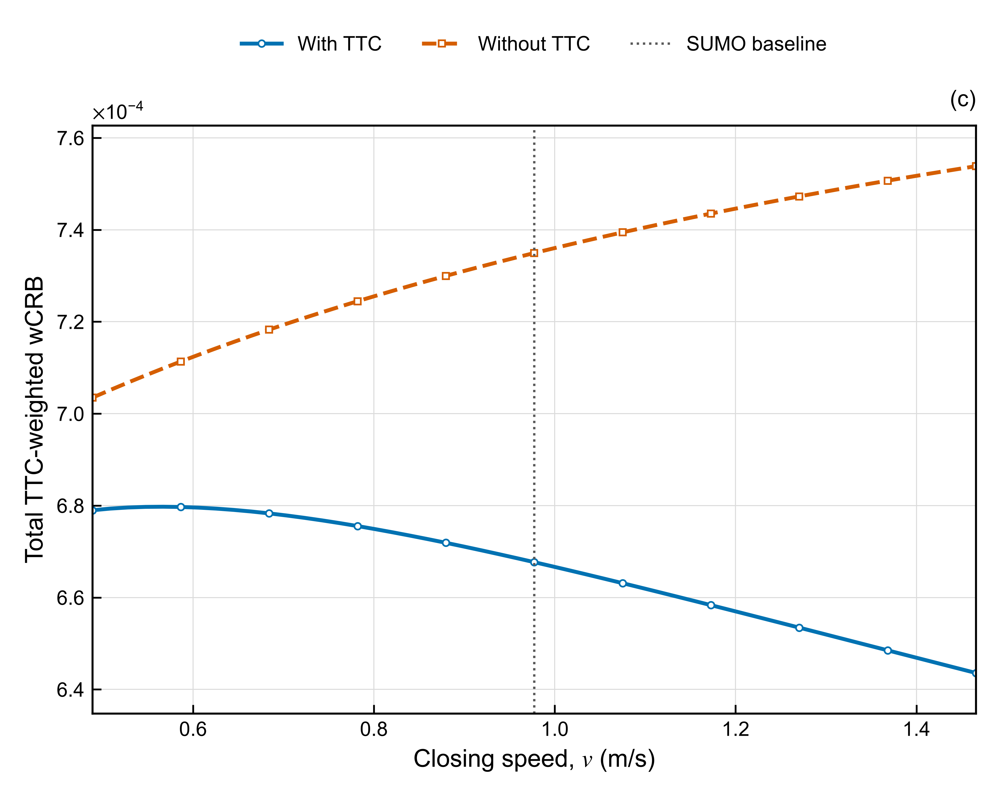
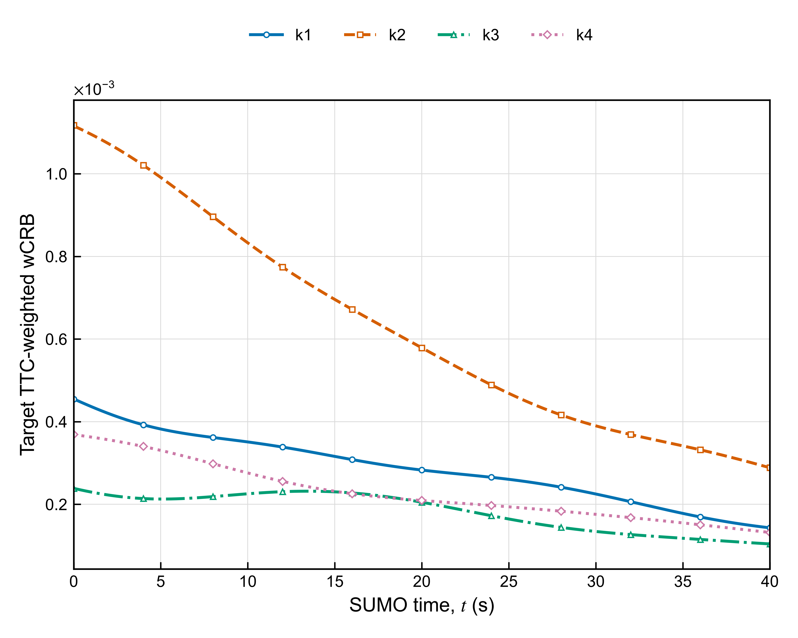

# 车载 ISAC 图7至图9复现实验及 DNN 候选搜索验证

实验日期：2026年10月19日。

## 1 实际结论

图7、图8(a)、图8(b)、图8(c)、图9共五张图已经用未修改的旧模型和新启动的SUMO完整重新计算。交通状态及所有选定资源和图形CSV字段相对历史记录最大绝对差为0；数值保持一致。五张图以5比4画布导出PNG、PDF、SVG，横轴首末点贴合两端，不做缩放、曲线拟合或平滑。

含噪维护回波Full ML的三个快照及401周期检查通过；CNN在独立测试场景上基本保持状态估计质量，但端到端速度更慢，Gate4未通过。因此本次不把DNN接入P1/P2，不声称DNN改善了资源分配或已经实现加速。

| Gate | 内容 | 实际状态 |
| --- | --- | --- |
| 0 | 源代码哈希 依赖 SUMO版本 | 通过；SUMO 1.27.1 |
| 1 | 401周期固定目标交通复现 | 通过；无碰撞与缺失目标 |
| 2 | 旧模型资源分配与五张图复现 | 通过；选定CSV字段差值均为0 |
| 3 | 维护回波 Full ML与独立波形FIM检查 | 通过；离线影子观测 |
| 4 | 独立场景CNN候选搜索 | 未通过：当前CPU实现无端到端加速 |

## 2 源代码与运行环境

`实验/legacy/main.py`、`实验/legacy/model.py`和`实验/legacy/sumo/`是原工程逐字节快照，哈希记录在`结果/legacy_reproduction/environment_versions.json`中。`实验/scripts/reproduce_legacy.py`只调度并核对原求解程序；新模型位于`实验/src/radar_echo.py`；完整ML位于`实验/scripts/run_full_ml.py`；CNN、独立场景和四方法比较位于`实验/scripts/compare_methods.py`。此目录与旧项目隔离保存。

| 环境 | 本次版本 |
| --- | --- |
| Python | 3.12.14 (main, Aug 25 2026, 14:01:42)  |
| NumPy | 2.5.4 |
| SciPy | 1.18.1 |
| Matplotlib | 3.11.2 |
| PyTorch CPU | 2.14.1+cpu |
| SUMO | Eclipse SUMO sumo 1.27.1 |
| TraCI | 从实际SUMO_HOME/tools导入，与所用SUMO一致 |

本次通过本机TraCI端口运行SUMO，未调用远程服务。交通种子17。维护先验主种子47201，噪声主种子81000；快照噪声子种子0至15，整段实验20、21、22。CNN初始化与训练顺序种子66771。运行环境的完整解释器位置和源代码指纹保存在环境JSON中，PyCharm复现命令见README。

## 3 旧模型与最新建模的边界

对外按新论文编号：P1为系统总感知时间和功率优化，P2为目标驻留时间分配。旧代码`solve_p1`仍对应新论文P2；保留旧函数名与执行顺序，避免重编号改变结果。

| 项目 | 旧图基准 | 新增维护回波研究 |
| --- | --- | --- |
| 状态 | SUMO真值计算几何和风险 | 由粗跟踪先验限定候选，保留观测上做ML |
| 回波幅度 | 雷达方程 d^-4 接收功率在当前状态冻结后计算EFIM | 候选幅度随 d^-2 改变；RCS和损耗局部常量 |
| 相位与RCS | 未知复幅度被投影消元 | 相位0与RCS=10 m²视为已知校准值，是额外明确的影子实验假设 |
| FIM | 中心化快频率/慢时间，对角EFIM | 直接对当前有限维均值求导，保留幅度导数与交叉项，不消元未知复幅度 |
| TTC权重 | 所有四目标按径向TTC计算，权重和为4 | 维护估计模块暂不替换资源优化权重 |
| 邻车道风险 | 旧版本中可非零 | 最新理论中存在邻车道无纵向冲突时权重置零的规定，尚未混入旧图 |
| 预算 | 50ms帧内 Ts 与 Ps 硬约束 | 维护回波独立影子预算，不计入旧帧 |
| 结果标识 | legacy diagonal EFIM reproduction | shadow_deramped_known_rcs_phase_amplitude_dminus2_v1 |

因此“历史图逐点一致”只适用于旧模型。不能把上述旧图当作最新完整FIM和含噪状态驱动系统已经复现的证据；这两类结果输入与统计模型均不同。最新理论未完整给出可采样波形及所有维护参数，本次对其作了明确的LFM与已知相位RCS实例化，并保存所有假设。

## 4 交通恢复与逐点偏差

两车道直路E0，warm-up为2 s，记录t=0至40 s共401周期，决策步长0.1 s。ego初始位置500 m、速度25 m/s；k1前车580 m、24.6 m/s；k2后车390 m、25.95 m/s；k3相邻前车575 m、24.8 m/s；k4相邻后车425 m、25.2 m/s。没有切入，未使用历史cutin配置。速度参考函数逐字节复用原程序的低幅正弦设置，Krauss模型、车辆尺寸和全部安全设置保持原样。

保存了2005行车辆状态和1604行目标状态。位置、速度向量、视距距离、径向闭合速度、方位、TTC和权重均与历史数据一致。使用二维公式 v_close=−(V_k−V_ego)·(p_k−p_ego)/||p_k−p_ego||；不是直接将标量车速相减。

核验阈值预先写在脚本中：交通绝对容差1e-7；资源和绘图字段绝对容差1e-9、相对容差1e-7。实际各选定字段最大绝对偏差0，而非仅落在容差内。

| 复现CSV | 行数 | 选定字段最大绝对差 | 不匹配数 |
| --- | --- | --- | --- |
| cycles.csv | 401 | 0.0 | 0 |
| targets.csv | 1604 | 0.0 | 0 |
| fig7_multi_scenario_ao_trace.csv | 423 | 0.0 | 0 |
| fig8a_time_wcrb.csv | 401 | 0.0 | 0 |
| fig8bc_physical_sensitivity.csv | 102 | 0.0 | 0 |
| fig9_ttc_aware_target_wcrb.csv | 1604 | 0.0 | 0 |

## 5 图7至图9复现结果

共同参数：K=4、T=50 ms、Tmin=2 ms、Ps,max=50 mW、Es,max=1 mJ、fc=77 GHz、B=200 MHz、4Tx/4Rx、RCS=10 m²、损耗2、温度290 K、噪声系数6 dB、距离及速度归一化参考方差均1。通信带宽20 MHz、最低速率10 Mbps，通信SNR仍用原空间位置模型。完整参数保存在原`run_summary.json`和本次环境及场景JSON。

| 统计量 | 本次重新计算值 |
| --- | --- |
| TTC-aware平均总wCRB | 0.0013210345054897126 |
| Risk-unaware平均总wCRB | 0.0014040399919054947 |
| 以Risk-unaware作分母的改善 % | 5.91190328582672 |
| Ts最优范围 ms | 42.93646205 至 43.09032906 |
| Ps最优范围 dBm | 13.65619236 至 13.67172448 |

### 图7

同一高风险快照t=40 s上，三组距离和径向速度缩放独立重新求解。系统初值Ts=37 ms、Ps=21 mW；时间松弛0.08、功率松弛0.04；η=0禁用早停，实际运行140轮，末轮相对变化另行检查。曲线相近而终值分离来自实际物理系数。AO在耦合能量边界可能坐标锁定，小目标变化只能表示迭代稳定，不能由此宣称全局最优。

| 场景 | 距离比例 | 速度比例 | 初始wCRB | 末值wCRB | 末轮相对变化 |
| --- | --- | --- | --- | --- | --- |
| Scenario 1 | 0.992 | 1.015 | 0.0008487475937911613 | 0.0006468578631085995 | 1.8486388572864142e-09 |
| Scenario 2 | 1.0 | 1.0 | 0.0008764579726034273 | 0.0006679768242322293 | 1.8486389007891894e-09 |
| Scenario 3 | 1.008 | 0.985 | 0.0009048414040804156 | 0.0006896087399449166 | 1.8486392203779154e-09 |

### 图8

(a)横轴是完整SUMO时间；同一物理TTC权重评价TTC-aware与等权优化方案。阴影为四目标贡献的总体标准差，不是试验置信区间。(b)(c)分别对同一快照的k2距离和闭合速度做51点扫描，其余目标状态不变，并对每个扫描点完整求解系统及目标两层优化。旧EFIM的速度项不直接取决于目标速度，(c)的变化主要通过TTC与权重进入。

### 图9

仅TTC-aware方法，绘制k1至k4各自的ω_k·CRB_k。它能展示风险贡献分配，但不能单靠该图证明所有低风险目标未被牺牲。

## 6 维护回波与完整 ML

基础模型保持 μ=A(d)x(u−2d/c)exp[j2π(2vfc/c)t]，A(d)∝d^-2。采用单位功率、5 µs矩形支撑LFM脉冲，带宽200 MHz，另存1250点250 MHz波形样本。维护功率50 mW，256脉冲，PRI=40 µs，观测跨度10.24 ms，每目标发射开启时间1.28 ms、能量64 µJ。四目标维护总能量256 µJ，此预算未计入旧图，不主张已与50 ms帧实现在线联合调度。

以粗距离去斜后，残余拍频为−κ·2(d−d_coarse)/c，加上多普勒。候选距离窗口±3 m对应残余带宽小于±1 MHz，因此采用理想低通后的2 MHz观测是低维信号模型，而不是用2 MHz直接采样200 MHz原始LFM。取脉冲共同内部约3 µs门内6个快时间样本，并将连续4个脉冲做精确相干均值，得到6×64复数观测；保留相干均值依赖速度的因子。

低维白噪声直接按理想去斜滤波后的统计模型生成，方差N0·fs_residual/4，N0=kBT·F，复高斯实虚部分各一半。未逐点模拟原始250 MHz ADC噪声经实际模拟滤波器的过渡过程；理想滤波、远离脉冲边界和stop-and-hop近似是明确边界。完整ML指保留低维观测上的完整候选网格搜索，不声称它等于全部原始ADC数据的ML。

粗先验由独立模拟的已建立跟踪测量给出，距离标准差0.75 m、速度标准差0.15 m/s。只有离线传感器生成器和事后评分接触SUMO真值；ML接口只读取复数观测及粗先验。搜索窗口预设±3 m和±0.6 m/s，步长0.05 m、0.02 m/s，共121×61=7381点；不以真值直接构造理想中心窗口。这是高斯误差先验的传感器模拟，不是已实现的真实跟踪器；未验证先验误差存在长尾或相关性时的表现，后续需用实际跟踪输出替换。

每个候选保留随距离变化的幅度、传播时延以及多普勒；同一观测上计算||y−μ||²/σ²。所有似然值、最优索引、噪声种子、边界样本、FIM和耗时保存到CSV及NPZ。

| 检查 | 数值 |
| --- | --- |
| 直接回波去斜与低维均值相对误差 | 2.865292920254336e-14 |
| 解析与数值FIM相对误差 | 2.1770650864917718e-08 |
| 筛选候选与逐点重建似然最大绝对差 | 1.1368683772161603e-13 |

本次数值FIM直接计算2Re(DμᴴDμ)/σ²，包含距离幅度导数和交叉项。独立检查点的Jdv约2.4516，说明未把新FIM强制置为旧对角模型。

| 试验 | 样本数 | 距离RMSE m | 速度RMSE m/s | 先验距离RMSE m | 先验速度RMSE m/s |
| --- | --- | --- | --- | --- | --- |
| 0 20 40 s快照 | 192 | 0.2985416288723526 | 0.03278846603426296 | 0.7518823499300145 | 0.15259433742326275 |
| 401周期 | 4812 | 0.11620267575924889 | 0.017978294444403315 | 0.7554051965253156 | 0.14930356286336133 |

快照试验：每个时刻4目标×16个独立噪声种子，共192次；全时域：401×4×3，共4812次。两组均无真值落出预设网格；各有1例边界最优候选，已保留未删除。Full ML通过预先设定的距离RMSE<1 m、速度RMSE<0.25 m/s、无噪声网格误差及正定FIM检查。

## 7 CNN 设计与独立测试

新增8组SUMO交通场景，仅用于离线候选搜索数据。各场景继续运行40 s和401周期，无碰撞或ID替换；在0、5、…、40 s采样四目标，每状态16个独立噪声实例。训练4场景2304例，验证2场景1152例，测试2场景1152例，不把同一条轨迹相邻周期随机拆分。

| 场景 | 集合 | 目标距离间隔偏移 m | 速度参考与车型上限偏移 m/s |
| --- | --- | --- | --- |
| 0 | train | -12 | -0.08 |
| 1 | train | 12 | 0.08 |
| 2 | train | -6 | 0.04 |
| 3 | train | 6 | -0.04 |
| 4 | validation | -15 | -0.05 |
| 5 | validation | 15 | 0.05 |
| 6 | test | -18 | -0.12 |
| 7 | test | 18 | 0.12 |

第一次生成测试场景时发现出发速度超过对应车型速度上限，SUMO拒绝运行。修正为所有独立场景统一按既定速度偏移同步更新目标车型上限，保持安全余量；此修正不依赖测试精度或曲线结果。随后完整重生8场景。

小型CNN为2→12→16通道的两层3×3卷积和ReLU，池化到3×8，拼接粗距离、粗速度和观测SNR，96维隐藏层，77区块分类头及仅供直接回归基线使用的2维回归头。训练40轮、Adam学习率0.001、batch128；分类CE加0.5倍回归MSE，验证损失选择检查点。离线Full ML只生成标签，不作为线上输入。

候选划为11×7个不重叠区域，允许保留多个峰。验证集比较累计概率阈值0.95、0.99、0.995、0.999；未达到99%前回退覆盖率的阈值不调测试集，按预设规则使用0.999。选择候选后仍用原物理似然求最优点；候选预算超过40%、边界最优点或标准残差超过1.3时回退完整网格。

测试前回退候选覆盖率为98.784722%；含回退后的覆盖率为99.565972%。两者分开保存，避免以回退后的结果掩盖网络本身遗漏。所有方法使用同一份含噪回波，计时包括实际预处理、网络推理、候选筛选、物理似然与必要回退；教师评分从计时区间移出。

| 方法 | 距离RMSE m | 速度RMSE m/s | 平均耗时 ms | 相对Full ML加速比 | 平均似然次数 | 回退频率 |
| --- | --- | --- | --- | --- | --- | --- |
| Full-Grid ML | 0.18800529 | 0.02643721 | 0.515333 | 1.000000 | 7381.00 | 0.0 |
| Coarse-to-Fine ML | 0.18344051 | 0.02920422 | 0.485319 | 1.061843 | 577.00 | 0.0 |
| DNN Direct Regression | 0.59790834 | 0.16664465 | 0.744901 | 0.691814 | 1.00 | 0.0 |
| DNN-Adaptive-ML | 0.18831197 | 0.02645516 | 2.918183 | 0.176594 | 4871.30 | 0.3402777777777778 |

失败样本已保存：5例DNN-Adaptive-ML遗漏完整ML最优点或其目标值存在非零差异。最大NLL差为96.573701。不能用总体RMSE相近来掩盖这些样本。

当前Full ML已通过回波可分离结构向量化，完整网格速度很快。网络推理与区域调度开销、约34%的回退，以及非矩形候选的精确评价开销，超过所节省的候选计算。减少似然次数没有转化为端到端加速，这是本次Gate4未通过的具体原因。

## 8 约束与后续条件

本轮旧图的全部时间、功率、能量、通信QoS与驻留时间约束保持满足，检查残差保存在逐周期CSV和原运行摘要。新维护回波未混入旧预算，独立CNN试验未接入资源优化。

下一步应先分析失败候选区域、置信度校准、在线批处理开销和向量化ML基准的公平计时；使用新的独立验证场景作选择，不能在本次测试集上反复调阈值。若以后使用未知RCS/相位，必须另设统计模型并重新定义完整ML和FIM。若接入最新论文系统，还需按新规定处理邻车道纵向风险、维护时间与能量开销，再独立比较估计驱动与SUMO真值驱动结果；不能要求两者复制旧的5.9119%数值。

## 9 输出目录

`图片/` 为五张主图及源数据；`结果/legacy_reproduction/` 为历史逐点核对及完整SUMO复现；`结果/full_ml/` 为完整似然分布、含噪回波、估计和采样参数；`结果/dnn_ml/` 为场景、训练、测试、回退和失败样本；`结果/figure_qa/` 为主图文字及碰撞检查。所有CSV、NPZ和模型权重保留，不以图片替代原始实验记录。

| 主图 | 图形碰撞检查 | 最小字体 pt |
| --- | --- | --- |
| fig7_multi_scenario_ao_convergence | PASS | 6.3 |
| fig8a_time_wcrb | PASS | 6.3 |
| fig8b_range_sensitivity | PASS | 6.3 |
| fig8c_speed_sensitivity | PASS | 6.3 |
| fig9_ttc_aware_target_wcrb | PASS | 6.3 |

## 仓库数据分卷

超过GitHub单文件限制的完整似然NPZ以无损分卷保存，每卷40 MiB以内，附原文件和各卷SHA256。运行`python 实验/scripts/restore_large_artifacts.py`恢复；本地原始NPZ未修改。
